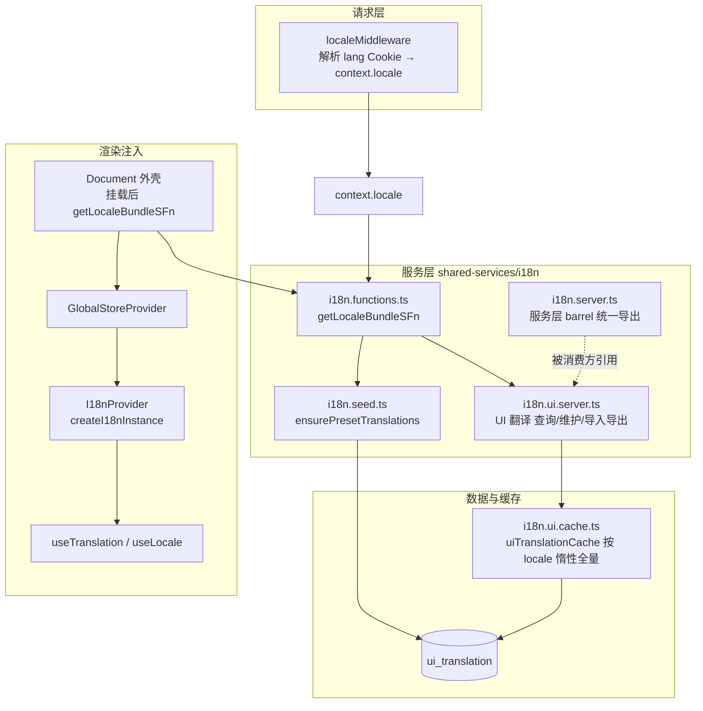
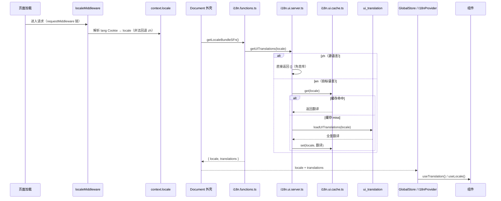
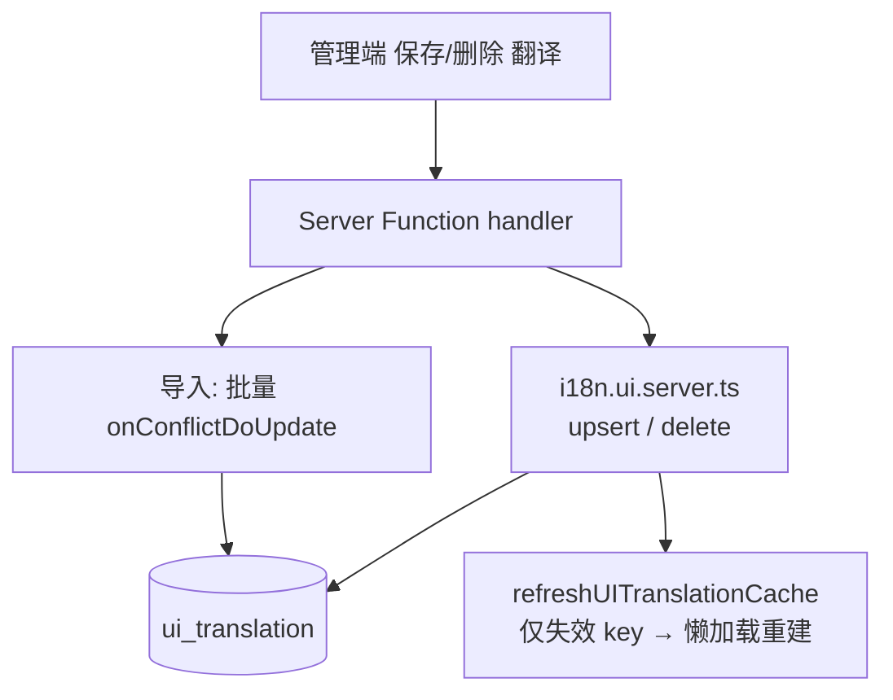

# 国际化（i18n）

> 定位：平台机制类 · 人类阅读
> 单一事实来源：`src/shared-services/i18n/*`（类型/服务/种子）、`src/db/schema/translation.ts`（`ui_translation` 表）、`src/components/providers/*`（Provider 与 hooks）
> 引用关系：← 被 architecture-overview、README「文档」索引、i18n skill 链接；→ 引用 i18n 代码单一事实来源
> 更新触发：i18n 链路 / 语言检测 / 缓存策略 / 新增语言变更时

## 概述

本项目采用**中文原文作为翻译 key** 的国际化方案，基于 i18next + react-i18next，**只覆盖前台页面**的固定文案：key 为中文原文（如 `t("首页")`），目标语言映射到 `ui_translation` 表的英文值；进程内按 locale 惰性全量缓存。管理端（`/admin/*`）是中文界面，文案硬编码中文、不参与翻译。

> 数据库实体字段**不做多语言**：实体只保存原文一份，需要多语言展示的文案走 UI 翻译表。
>
> 事实以代码为准：支持语言、Seed 清单、缓存实例分别见 `i18n.types.ts`、`i18n.seed.ts`、`i18n.ui.cache.ts`。

## 架构总览



## 翻译模型

| 维度 | 值 |
|------|-----|
| 表 | `ui_translation` |
| 用途 | 前台固定文案 |
| 定位键 | `(locale, key)`，key 为中文原文 |
| 缓存 | `uiTranslationCache` 按 locale 惰性全量 |
| 合并 | i18next 直接读取 resource |
| 默认语言 | zh 直接返回 key（资源恒空，免查库） |

> 表结构与唯一约束以 `src/db/schema/translation.ts` 为准。

## 语言检测与首屏加载

应用启动时按下列链路确定语言并渲染，`localeMiddleware` 是 locale 默认值的唯一权威来源（非法 Cookie 值回退 `zh`）：



> 语言、翻译与站点配置由外壳（`components/Document.tsx`）挂载后取一次，取回前只渲染占位；管理端不消费翻译但也走同一条链路，外壳按路径决定是否注入 `GlobalStoreProvider`。

## 目录与文件结构

```
src/shared-services/i18n/
├── i18n.types.ts            # 共享类型 + locale 常量（客户端安全，可任意模块引用）
├── i18n.config.ts           # createI18nInstance —— i18next 实例（客户端安全）
├── i18n.seed.ts             # ensurePresetTranslations —— 英文种子数据
├── i18n.functions.ts        # Server Function 包装器（getLocaleBundleSFn）
├── i18n.server.ts           # 服务层 barrel：统一 re-export UI 翻译服务与类型
├── i18n.ui.server.ts        # UI 翻译 服务层（查询/维护/导入导出）
├── i18n.ui.schemas.ts       # UI 翻译 zod schema（formSchema / getListSchema / deleteSchema）
├── i18n.ui.cache.ts         # uiTranslationCache（MemoryCache，按 locale 分片）
└── __tests__/               # i18n.test.ts / i18n.seed.test.ts
```

> **`.server.ts` 命名约束**：`i18n*.server.ts` 带 `.server` 分界标记，受 TanStack Start `importProtection` 保护（客户端禁止导入），服务层逻辑必须保留该后缀。

## 服务层关键文件

| 文件 | 职责 |
|------|------|
| `i18n.types.ts` | `SUPPORTED_LOCALES` / `Locale` / `DEFAULT_LOCALE` / `LOCALE_COOKIE` / `localeSchema` / `Translations` / `TranslationImportResult` |
| `i18n.config.ts` | `createI18nInstance()`——创建 i18next 实例，注入 resource、默认 `{{}}` 插值、`returnNull:false` |
| `i18n.server.ts` | barrel：统一 re-export 服务层函数与导入导出类型 |
| `i18n.functions.ts` | Server Function 包装：`getLocaleBundleSFn`（外壳启动时调用一次） |
| `i18n.seed.ts` | 英文种子数据 `SEED_DATA` + `ensurePresetTranslations`（启动 `onConflictDoNothing` 增量写入） |
| `i18n.ui.server.ts` | UI 翻译：`loadUITranslations` / `getUITranslations` / `refreshUITranslationCache` / `list` / `upsert` / `delete` / `getAll…ForExport` / `importUiTranslations` |
| `i18n.ui.schemas.ts` | UI 翻译 zod schema（`formSchema` / `getListSchema` / `deleteSchema`） |
| `i18n.ui.cache.ts` | `uiTranslationCache`（MemoryCache 按 locale 分片） |
| `providers/i18n-context.tsx` | `I18nProvider` + `useTranslation` / `useLocale` hooks |
| `providers/global-store.tsx` | `GlobalStoreProvider`——注入 locale / translations / systemConfig 并装配 I18nProvider |
| `middleware/locale-middleware.ts` | `localeMiddleware`——解析 lang Cookie 注入 `context.locale` |

## 缓存与写路径

- **UI 翻译缓存**：`i18n.ui.cache.ts` 的 `uiTranslationCache` 按 locale 存储整份 `Record<key, value>`，首次访问惰性加载（miss → 查库 → 写缓存）；**zh 恒返回空资源**（源语言，免查库）。管理端保存/删除/导入后调用 `refreshUITranslationCache(locale)` **仅失效缓存 key**，由下一次读取懒加载重建。
- **写入约定**（`i18n.ui.server.ts`）：ID 分支按 id 直改；新建分支基于唯一约束做**原子 `onConflictDoUpdate`**，消除并发 select-then-write 竞态。
- **导入**（`importUiTranslations`）：按唯一键去重后**批量 `onConflictDoUpdate`** 一次写入（单次预查询统计新增/更新），避免逐条 select，并规范化 `valueType`（拷贝数据，不污染入参）。



## 管理端维护

| 能力 | 说明 |
|------|------|
| UI 翻译管理 | `/admin/translations/ui`（`translation:view` / `translation:manage`）——按语言/关键词检索、增删改 |
| 导入 / 导出 | 支持 JSON 导出与导入（`translation:export` / `translation:import`） |

> 权限码定义见 `src/permissions/admin-permissions.ts`；管理端为中文 SPA，管理页文案不参与翻译。
> 默认语言（zh）为源语言，在翻译管理端只读：不出现在新增/筛选的语言下拉中，表中的 zh 条目仅可查看不可编辑/删除。

## 扩展新语言

1. `i18n.types.ts`：`SUPPORTED_LOCALES` 追加语言码，`LOCALE_LABELS` 追加语言标签。
2. `i18n.seed.ts`：新增 `SEED_XX` 数组并合并进 `SEED_DATA`。
3. 管理端翻译页面语言选择基于 `SUPPORTED_LOCALES` 自动渲染。

## 相关文档

- 规则与操作指引 → `.agents/skills/i18n/SKILL.md`
- 缓存机制 → `cache-system.md`（缓存实例以代码为准）
- 数据库表 → `database-design.md`（`ui_translation` 结构）
- 权限模型 → `auth-permission-model.md`（翻译相关权限码）
